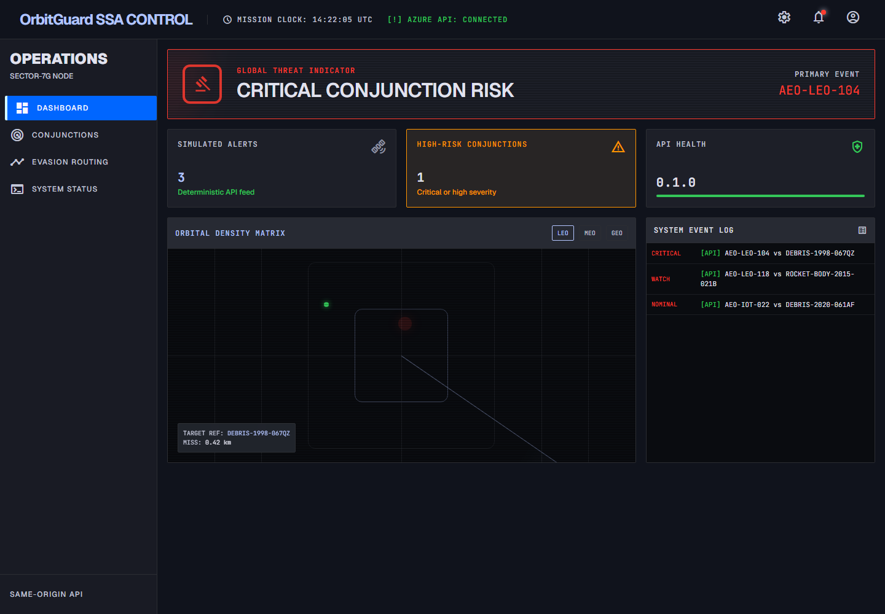
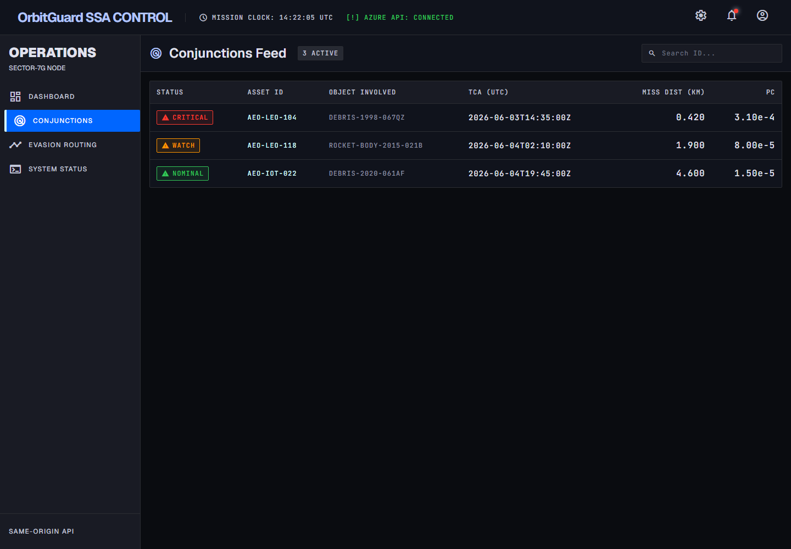
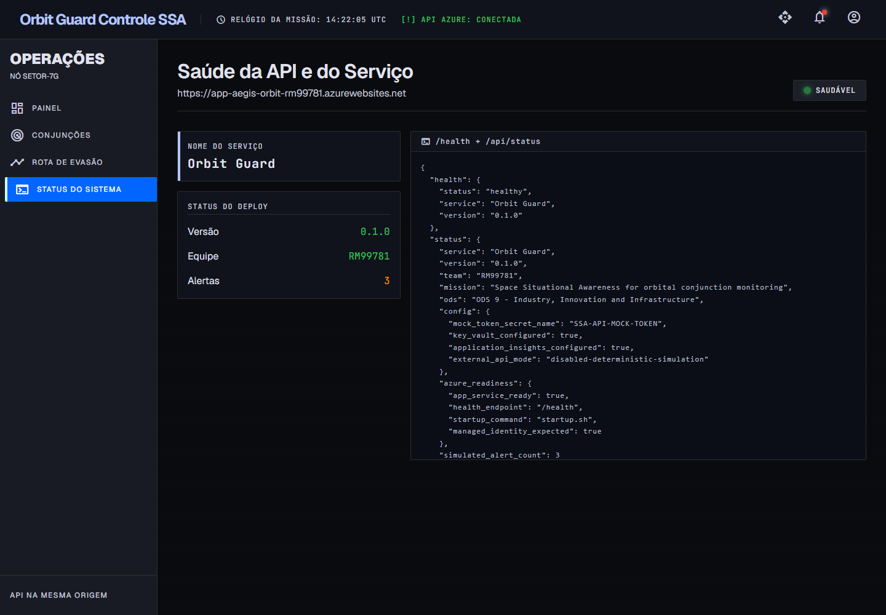
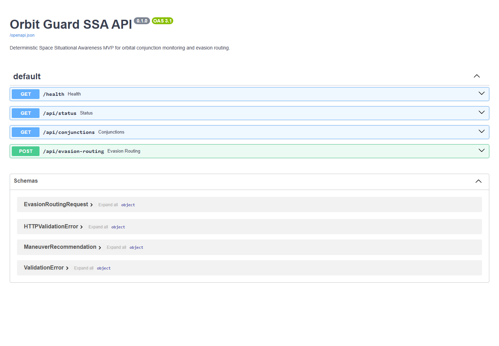
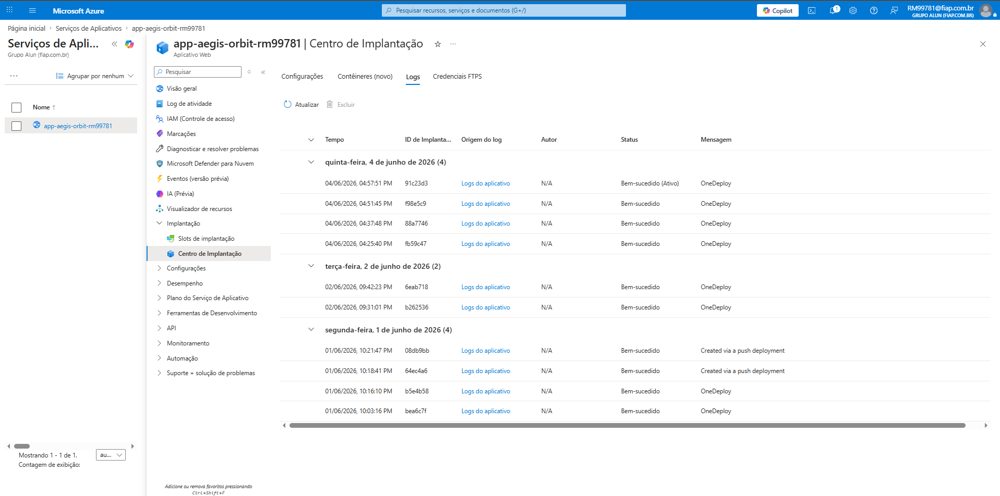

<div align="center">

# 🛰️ Orbit Guard

**Space Situational Awareness (SSA) MVP that flags orbital conjunctions and recommends collision-avoidance maneuvers.**




</div>

---

## ✨ Overview

Orbit Guard helps satellite operators react to **conjunction events** (a satellite getting dangerously close to debris or another object). The API serves a deterministic catalog of conjunction alerts, classifies collision risk from **miss distance** and **collision probability (Pc)**, and returns an evasive maneuver plan with an ignition window, estimated **Δv**, expected risk reduction and residual Pc.

The React dashboard is built and served by the FastAPI app itself under `/app`, and everything ships to **Azure App Service** through a GitHub Actions pipeline with tests, build, deploy and a public smoke test. The project is aligned with **UN SDG 9** (Industry, Innovation and Infrastructure).

## 🚀 Features

- 📡 **Conjunction alerts:** `GET /api/conjunctions` returns the monitored events (satellite, object, time, miss distance, relative velocity, Pc, severity)
- 🧮 **Risk classification:** `nominal`, `watch`, `high` and `critical` levels from Pc and miss-distance thresholds
- 🚀 **Evasion routing:** `POST /api/evasion-routing` computes Δv, a 12-minute ignition window, risk reduction % and residual Pc, with a readable explanation
- ✅ **Input validation** with Pydantic (ID pattern, physical ranges for distance, velocity and probability)
- 🩺 **Health and status:** `/health` and `/api/status`, which reports Key Vault and Application Insights configuration
- 📖 **Swagger UI** at `/docs`
- 🖥️ **Dashboard pages:** overview, conjunctions, evasion routing and system status

## 🧱 Tech Stack

| Layer | Technologies |
| --- | --- |
| API | Python 3.12, FastAPI, Pydantic, Uvicorn |
| Frontend | React 19, React Router, TypeScript, Vite, Tailwind CSS |
| Tests | Pytest + FastAPI `TestClient` |
| Cloud | Azure App Service (Linux), Key Vault + Managed Identity, Application Insights, Log Analytics, HTTP 5xx alert rule |
| CI/CD | GitHub Actions: test → build frontend → Azure login → deploy → smoke test |

## 🗂️ Project Structure

```text
.
├── app/main.py                  # FastAPI app: SSA logic, API routes, SPA hosting
├── frontend/                    # React + Vite dashboard (served at /app)
├── tests/test_app.py            # API tests
├── scripts/
│   ├── provision_azure.ps1      # resource group, App Service, Key Vault, App Insights, alerts
│   ├── deploy_azure.ps1         # zip deploy to App Service
│   └── update_deploy.ps1
├── startup.sh                   # App Service startup command
├── .github/workflows/deploy.yml # CI/CD pipeline
└── docs/                        # technical documentation (PDF) and evidence screenshots
```

## ⚙️ Getting Started

```bash
# API
python -m venv .venv && source .venv/bin/activate   # Windows: .venv\Scripts\activate
pip install -r requirements.txt
python -m pytest
uvicorn app.main:app --reload                        # http://localhost:8000/docs

# Frontend (served by the API at /app after building)
npm ci --prefix frontend
npm run build --prefix frontend                      # then open http://localhost:8000/app/
```

Try the maneuver endpoint:

```bash
curl -X POST http://localhost:8000/api/evasion-routing \
  -H "Content-Type: application/json" \
  -d '{"satellite_id":"AEO-LEO-104","miss_distance_km":0.42,"relative_velocity_kms":12.8,"collision_probability":0.00031}'
```

Optional environment variables: `KEY_VAULT_NAME`, `SSA_API_MOCK_TOKEN_SECRET_NAME`, `APPLICATIONINSIGHTS_CONNECTION_STRING`.

## 📸 Screenshots

| Conjunctions | System status |
| --- | --- |
|  |  |
| **Swagger** | **Azure CI/CD logs** |
|  |  |

Full write-up (Portuguese): [docs/Orbit-Guard-technical-documentation.pdf](docs/Orbit-Guard-technical-documentation.pdf)

## 🎓 Academic Context

Built as a **Global Solution** project (Secure DevOps Tools & Cloud Computing) for the Software Engineering program at **[FIAP](https://www.fiap.com.br/)**.

**Team:** João Pedro de Albuquerque Oliveira · Pedro Augusto Carneiro Barone Bomfim · Matheus Augusto Santos Rego
